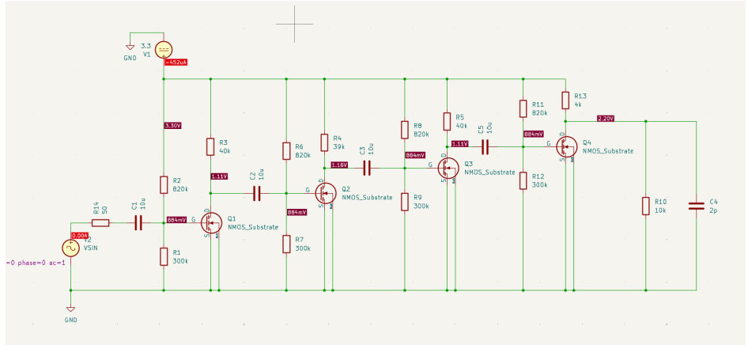
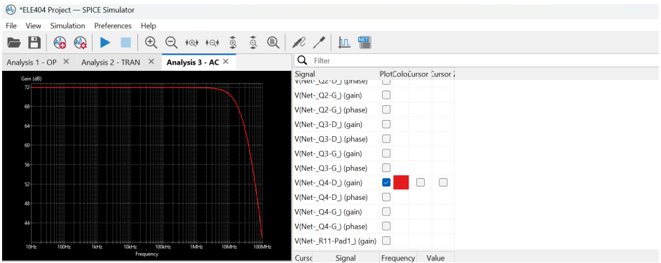
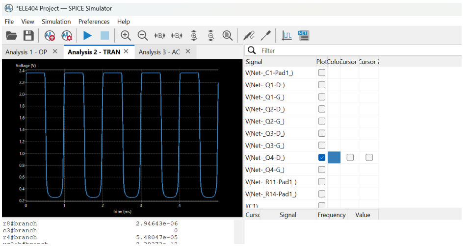

# Four-Stage CMOS Common-Source Amplifier (KiCad SPICE)

A cascaded four-stage common-source MOSFET voltage amplifier, sized by hand and then checked in KiCad's SPICE simulator. It was completed for ELE404 at Toronto Metropolitan University, using GlobalFoundries 180 nm CMOS process parameters and a single 3.3 V supply.

## Design Goals

- Overall gain of at least 60 dB
- -3 dB bandwidth of 500 kHz or more
- No more than 40 dB of gain in any single stage
- Less than 10% gain drop when driving a 10 kΩ load
- Output swing larger than 1.5 Vpp

## Design Overview

- **Biasing:** Each transistor is set to I_D = 50 µA with V_OV = 0.254 V, which gives W/L = 15.5 µm / 1 µm.
- **Gate bias network:** An 820 kΩ / 300 kΩ resistor divider sets V_GS ≈ 0.884 V.
- **Hand analysis:** Transconductance (g_m), output resistance (r_o), and the gain of each stage.
- **Simulations run:** DC operating point, AC frequency sweep, and transient.

## Repository Layout

- `kicad/` – KiCad project and schematic files
- `images/` – schematic and simulation screenshots
- `docs/` – complete design report (PDF)

## Results

| Metric | Target | Hand Calculation | Simulation |
|---|---|---|---|
| Total gain | ≥ 60 dB | 69 dB | ~70–72 dB |
| -3 dB bandwidth | ≥ 500 kHz | ~27.8 MHz | ~15 MHz |
| Gain per stage | ≤ 40 dB | 23 dB | 24 dB |
| Output swing | ≥ 1.5 Vpp | n/a | ~2.3 Vpp |

**Known shortfall:** Total DC power came in near 1.5 mW, over the 1 mW goal. Each adjustment I tried to reduce power cost me another spec, so I chose to keep the gain and bandwidth targets intact.

### Schematic

### AC Analysis

### Transient Analysis

## Running the Simulation

1. Install KiCad.
2. Open the project file inside `kicad/`.
3. Launch the Simulator and pick the OP, AC, or Transient analysis.

## Tools

- KiCad with its built-in SPICE simulator
- GlobalFoundries 180 nm CMOS process parameters
